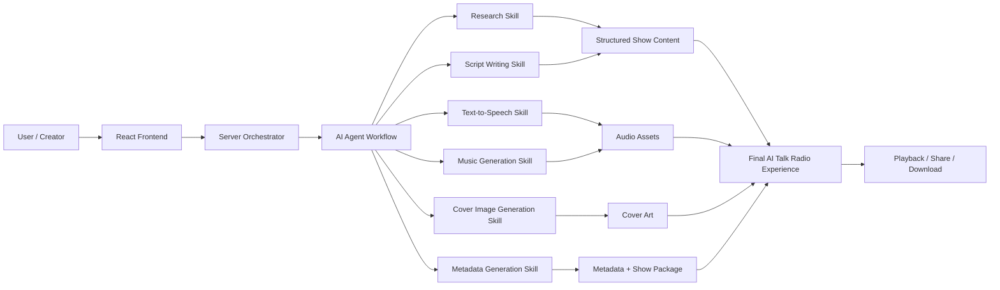
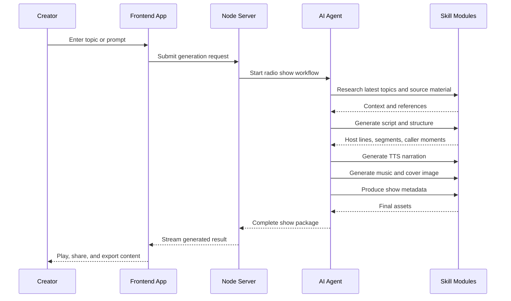

<div align="center">

</div>

# Remix AI Talk Radio

A modern AI-powered podcast and radio show generator built with React, Vite, Remix-style web app patterns, and a multi-step agent workflow. This project transforms source material into a polished simulated radio show with hosts, caller segments, background music, cover art, TTS narration, and metadata.

Keywords: AI radio generator, AI talk show generator, podcast generator with AI, AI radio app, Gemini podcast app, React AI podcast builder, automated radio show generation, AI content generation app, voice generator app

## Why this project matters

Creating a compelling talk radio show traditionally requires scripting, research, voice production, music selection, and post-production. This project demonstrates how an AI-driven workflow can automate those stages into a single experience: gathering context, generating scripts, creating voice output, mixing audio, and packaging the final show.

This repository is useful for developers and creators who want to explore:

- agentic workflows for content generation
- multimodal AI orchestration
- audio and text pipeline design
- web app integration with Gemini AI and cloud services
- automated podcast production in a full-stack application

## Project overview

Remix AI Talk Radio combines:

- a frontend web app for interacting with the radio generator
- a Node.js/Express server for orchestration and API routes
- a structured AI agent with specialized skills for research, script writing, TTS, music, and cover generation
- cloud-ready integration points for Firebase, Google Storage, and AI services

## Architecture and data flow



## Sequential execution flow



## Core features

- AI-generated radio show scripts and formats
- research-driven content gathering from sources such as GitHub and HN
- host and caller dialogue simulation
- text-to-speech generation for audio segments
- background music mixing and audio production
- cover image generation for show branding
- metadata and packaging generation for publication
- interactive web UI for browsing and editing produced content
- Firebase and cloud storage-ready architecture

## Benefits

### 1. Faster content creation
The project reduces the time required to research, script, narrate, and package a radio show.

### 2. More creative experimentation
Creators can test multiple formats, tones, and episode ideas with minimal manual setup.

### 3. Multi-step AI orchestration
The system demonstrates how different specialized skills can work together to create a polished output.

### 4. Modular and extensible architecture
Each skill can be replaced, upgraded, or extended independently without disrupting the full pipeline.

### 5. Modern web + AI integration
This is a realistic example of combining frontend UX, server orchestration, and AI services in one product.

## Use cases

- AI-generated talk radio or podcast episodes
- educational content automation for niche topics
- branded media storytelling for product updates or communities
- marketing and content production experiments
- AI-powered news or trend shows
- interactive demo applications for GenAI workflows
- internal tools for audio storytelling and social media content generation

## Technology stack

- React
- Vite
- Node.js
- TypeScript
- Express
- Google Gemini / GenAI SDK
- Firebase / Firebase Admin
- Google Cloud Storage
- Python-based AI skills for generation tasks

## Project structure

```text
Remix-AI-Talk-Radio/
├── agent/
│   ├── AGENTS.md
│   ├── agent.yaml
│   ├── requirements.txt
│   └── skills/
│       ├── audio-mixing/
│       ├── cover-image-generation/
│       ├── metadata-generation/
│       ├── music-generation/
│       ├── research/
│       ├── script-writing/
│       └── tts-generation/
├── src/
│   ├── App.tsx
│   ├── components/
│   ├── data.ts
│   ├── lib/
│   ├── main.tsx
│   └── types.ts
├── server.ts
├── server/
│   └── lib/
├── public/
├── assets/
├── index.html
├── index.css
├── package.json
├── vite.config.ts
├── tsconfig.json
├── .env.example
├── firebase-applet-config.json
├── metadata.json
├── logo.svg
├── README.md
└── .gitignore
```

## How it works

1. The user provides a topic or content brief.
2. The backend server accepts the request and routes it through the AI agent.
3. Research skills gather relevant source material.
4. Script-writing skills transform research into a radio-style conversation.
5. TTS skills generate narration from the script.
6. Music generation and audio mixing create a richer listening experience.
7. Cover art and metadata are produced for packaging and distribution.
8. The final result is returned to the frontend for playback, exporting, or sharing.

## Getting started

### Prerequisites

- Node.js 18+
- npm or yarn
- A valid Gemini API key

### 1. Clone the repository

```bash
git clone https://github.com/hasanmonsur/Remix-AI-Talk-Radio.git
cd Remix-AI-Talk-Radio
```

### 2. Install dependencies

```bash
npm install
```

### 3. Configure environment variables

Copy the example env file and add your API key:

```bash
cp .env.example .env.local
```

Then set:

```bash
GEMINI_API_KEY=your_api_key_here
```

### 4. Run the app locally

```bash
npm run dev
```

## App behavior

The app is built around an interactive AI media workflow. Users can initiate a show generation process, review the content, and receive produced media assets that reflect a simulated broadcast experience.

## Why this repository stands out

This project is valuable because it demonstrates end-to-end AI content production in a single application. It combines research, generation, audio output, and packaging in a workflow that feels like a real creative production pipeline.

## SEO summary

This repository is designed to be discoverable for search terms such as:

- AI radio generator
- AI talk show generator
- podcast generator app
- Gemini AI podcast app
- artificial intelligence radio app
- AI podcast workflow
- React AI content generation app
- AI show production app
- generative audio app

By combining AI workflow architecture, clear technical structure, modern web app patterns, and industry-relevant keywords, this README is structured to improve search visibility and repository discoverability.

## License

This project is intended for creative experimentation, demonstration, and AI-driven media generation research.

## Run locally

The project already contains a GitHub banner and setup flow. To run it locally:

```bash
npm install
npm run dev
```

Set your Gemini API key in `.env.local` before launching the app.
